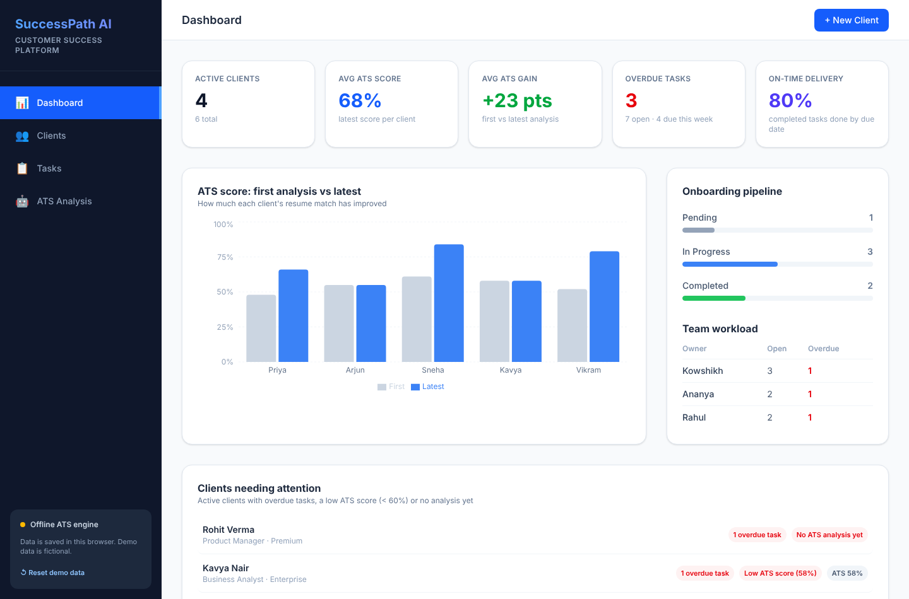
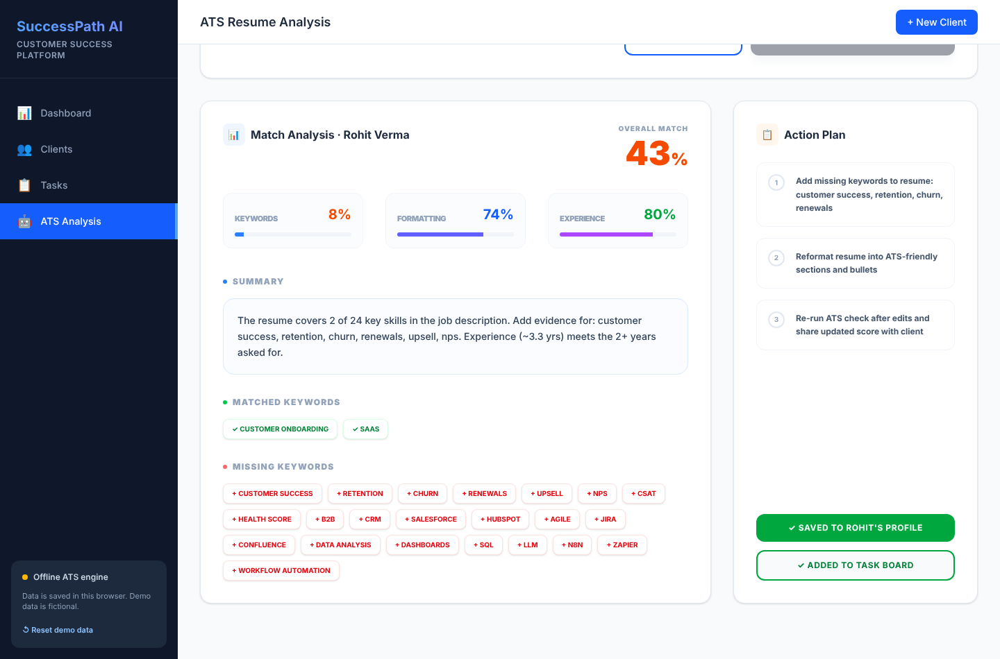
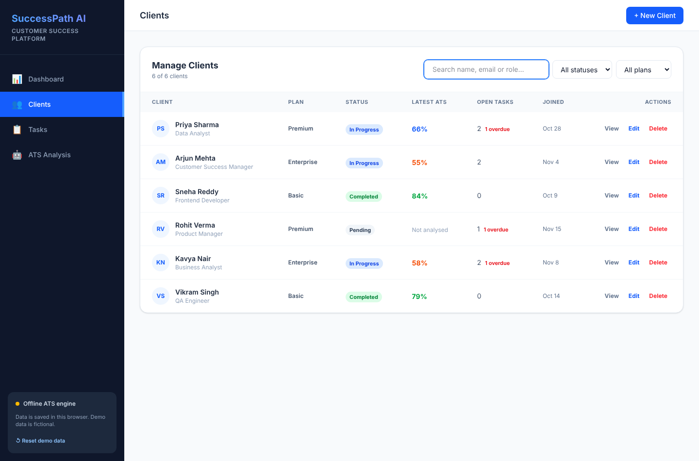
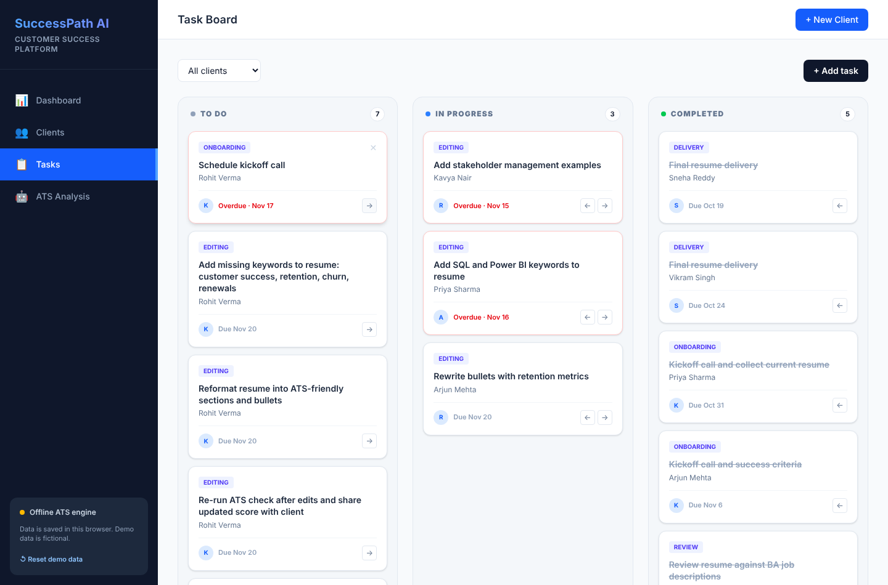

# SuccessPath AI: Customer Success Platform

A web app for Customer Success teams at resume and job-search services. It brings **client onboarding, ATS resume analysis and delivery tasks** into one workspace, and shows the team which clients need attention today.

Built with React + TypeScript and Google Gemini, with a built-in offline ATS engine so the whole app works without an API key.

    



---

## The problem

A CSM handling dozens of job-seeking clients usually juggles a client sheet, a task tracker and a separate ATS checker. Nothing connects them, so it's hard to answer:

- *Which clients are falling behind right now?*
- *Is each client's resume actually getting better?*
- *Who on the team is overloaded, and what's overdue?*

## What it does

| Area | Features |
|---|---|
| **Dashboard** | Live KPIs calculated from your data: active clients, average ATS score, average ATS improvement, overdue tasks, on-time delivery rate. First vs latest ATS score per client, onboarding pipeline, team workload, and a **"clients needing attention"** list (overdue tasks, ATS score below 60%, or no analysis yet). |
| **Clients** | Search by name, email or target role. Filter by status and plan. See each client's latest ATS score and overdue tasks. Client profile with ATS history and task list. Add, edit and delete clients. |
| **Task board** | Kanban board (To Do → In Progress → Completed) with drag-and-drop or arrow buttons, overdue highlighting, filtering by client and an add-task form. Completion dates are recorded so on-time delivery can be measured. |
| **ATS analysis** | Score a resume against a job description (keywords, formatting, experience). Shows matched vs missing keywords, **saves the score to the client's profile** and turns the action plan into **tasks on the board** in one click. With a Gemini key, it can also rewrite the resume and export a PDF. |
| **Persistence** | Data is saved in the browser (localStorage) and survives reloads. You can reset to the demo workspace at any time. |

### Two ATS engines

| | Offline engine (default) | Gemini (with API key) |
|---|---|---|
| Cost / setup | Free, no key needed | Needs `GEMINI_API_KEY` |
| How it scores | Transparent rules: matches ~100 common skills and tools from the JD (50%), checks sections, contact info and bullets (20%), compares years of experience and quantified results (30%) | LLM reads both documents and returns structured JSON |
| Resume rewrite + PDF | – | ✓ |
| Fallback | – | If a Gemini call fails, the offline engine is used automatically |



| Clients | Task board |
|---|---|
|  |  |

## Run it locally

**Prerequisite:** [Node.js](https://nodejs.org) 18 or newer

```bash
git clone https://github.com/Kowshikhvarma/AI-Customer-Success-Platform.git
cd AI-Customer-Success-Platform
npm install
npm run dev          # open http://localhost:3000
```

**Optional: turn on Gemini.** Copy `.env.example` to `.env.local`, add your key from [Google AI Studio](https://aistudio.google.com/apikey), then restart `npm run dev`.

```bash
GEMINI_API_KEY=your-key-here
```

Other scripts:

```bash
npm test             # unit tests (Vitest)
npm run typecheck    # TypeScript check
npm run build        # production build in dist/
```

> **Note:** this is a front-end demo. The API key is bundled into the browser build, which is fine for local use. For a public deployment, move the Gemini calls behind a small backend.

## Project structure

```
├── App.tsx                    # app shell and routing between views
├── components/
│   ├── Dashboard.tsx          # KPIs, ATS progress chart, workload, attention list
│   ├── ClientList.tsx         # search, filters, client table
│   ├── ClientModal.tsx        # add / edit form and client profile
│   ├── TaskBoard.tsx          # kanban board with drag-and-drop
│   ├── ResumeAnalysis.tsx     # ATS analysis, save to client, create tasks, PDF export
│   └── Layout.tsx
├── lib/
│   ├── metrics.ts             # all dashboard calculations (pure functions)
│   ├── atsAnalyzer.ts         # offline ATS scoring engine
│   ├── store.ts               # state + localStorage persistence
│   ├── dates.ts, samples.ts
├── services/geminiService.ts  # Gemini calls with offline fallback
├── constants.ts               # fictional demo workspace
├── types.ts
└── tests/logic.test.ts        # 14 unit tests for metrics, ATS engine and store
```

## Tech stack

React 19 · TypeScript · Vite · Tailwind CSS · Recharts · Google Gemini API (`@google/genai`) · jsPDF · Vitest

All client data in the demo is fictional.

## Author

**Kowshikh Varma Balerao**, Customer Success Manager · [GitHub](https://github.com/Kowshikhvarma) · kowshikhvarma@gmail.com
